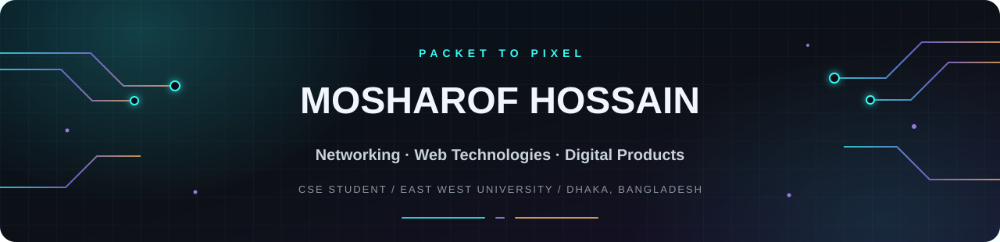

<!--
  MOSHAROF HOSSAIN — NEON CIRCUIT PROFILE
  Current GitHub username: ShadinWorld
  Put this file in the root of the public repository named exactly: ShadinWorld
-->

  
  
  

---

## `> whoami`

Hey! I'm **Mosharof Hossain**, a final-year Computer Science & Engineering student at **East West University** in Dhaka, Bangladesh.

I enjoy working where **networks, software, and useful digital products** meet. My academic and practical work includes campus network simulations, web applications, and data exploration. I like understanding how systems fit together—not just how to make a page look good.

- 🎓 **Study:** B.Sc. in Computer Science & Engineering, East West University
- 🌐 **Interested in:** Networking, web technologies, and digital product development
- 🧪 **Hands-on work:** Network simulation, academic resource platforms, storefronts, and data visualization
- 🧭 **My approach:** Learn the fundamentals, build something practical, then improve it

## `> tech_stack --grouped`

### Web & Product Development

### Programming & Tools

**Networking:** Cisco Packet Tracer · Cisco IOS CLI · IPv4 · CIDR/Subnetting · RIP · OSPF · EIGRP · DHCP/DHCP Relay · VLAN · NAT · ACL

Icons show technologies I've worked with or listed in my CV; they are not a claim of expert-level proficiency in every technology.

## `> featured_projects`

### 📚 EWU StudyHub — Academic Resource Platform
A student-focused resource platform built as an academic project, with work involving authentication, database integration, and file-storage workflows.

**Stack:** Next.js · TypeScript · Tailwind CSS · Supabase

[Open repository →](https://github.com/ShadinWorld/ewu-studyhub-web)

### 💻 Laptop Price Analysis
A data exploration and visualization project focused on examining laptop pricing patterns and presenting findings to support comparisons.

**Focus:** Data exploration · pricing-pattern comparison · visualization

[Open repository →](https://github.com/ShadinWorld/laptop-price-analysis)

### 🛒 Circuit Bazar — Digital Storefront
A storefront project for an electronics-components business, focused on product discovery and customer enquiries.

**Stack listed in my CV:** React · Vite · Firebase · Tailwind CSS

[Browse all repositories →](https://github.com/ShadinWorld?tab=repositories)

### 🌐 Multi-Campus Network Simulation
An academic Cisco Packet Tracer project involving a simulated seven-router topology, campus LANs, IPv4 addressing/subnetting, routing protocols, VLANs, NAT, ACLs, and connectivity testing.

## `> currently_focusing_on`

- 🧩 Strengthening full-stack development and database fundamentals
- 🛰️ Practising networking concepts through simulation and troubleshooting
- 🧑‍💻 Improving project documentation, usability, and maintainability

## `> github_activity`

### 🐍 Contribution trail

## `> connect`

*Thanks for stopping by. Feel free to explore the projects and follow along as I learn and build.*

<!-- Optional: add your LinkedIn URL when you have the exact public profile link. -->
