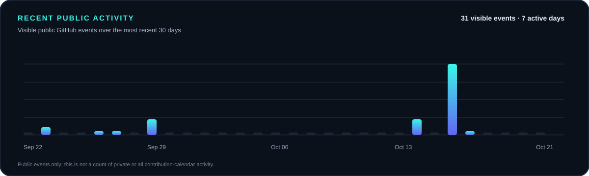
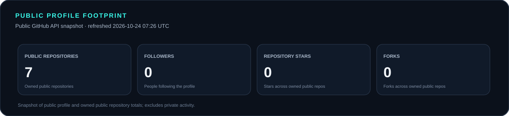
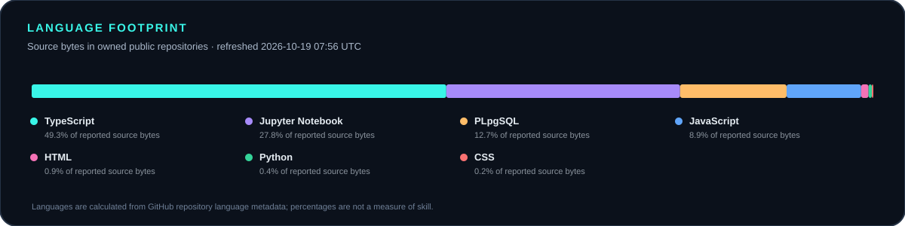
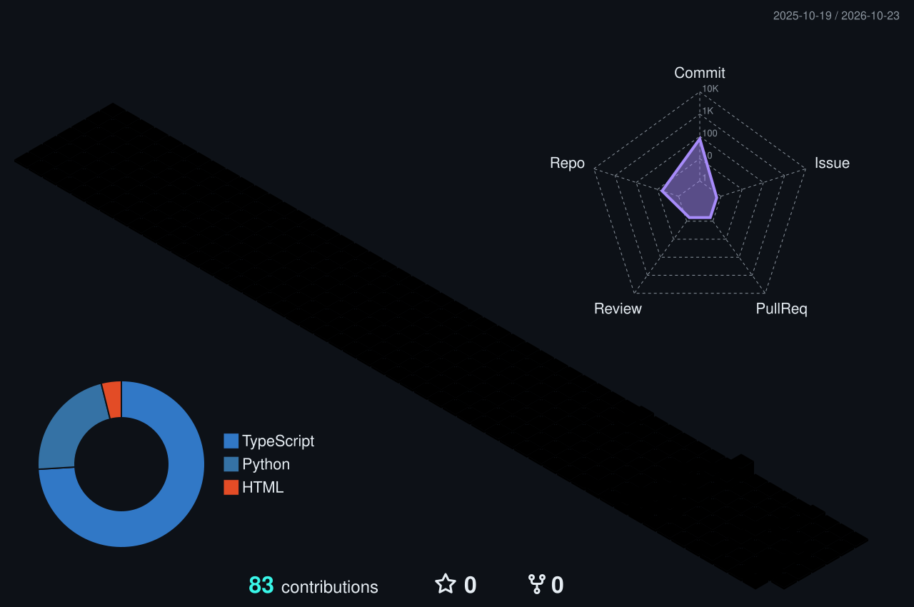
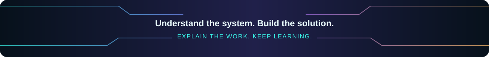

<!--
  MOSHAROF HOSSAIN | PACKET TO PIXEL
  Profile README for https://github.com/ShadinWorld
  Statements are based on the CV and projects shared by Mosharof.
-->

  
   
  
    
  
  
  
    
  
  

## `01 // SYSTEM PROFILE`

  <table>
    <tr>
      <td width="58%" valign="top">
        I'm <strong>Mosharof Hossain</strong>, a Computer Science &amp; Engineering student at <strong>East West University, Dhaka</strong>. I enjoy working where network fundamentals meet useful web products—understanding a problem, building a practical solution, and explaining the work clearly.
          
        My work includes campus network simulations, a student-focused academic resource platform, a digital storefront, and a laptop-pricing analysis project. Alongside coursework, I have <strong>2+ years of hands-on experience with Circuit Bazar's digital storefront and day-to-day business operations</strong>.
          
        <b>Location:</b> Dhaka, Bangladesh 
        <b>Degree:</b> B.Sc. in Computer Science & Engineering 
        <b>Expected graduation:</b> December 2026
      </td>
      <td width="42%" valign="middle" align="center">
        
        <b>My approach:</b> understand the system → build the solution → explain the work
      </td>
    </tr>
  </table>

## `02 // WHAT I BRING`

<table>
  <tr>
    <td width="50%" valign="top">
      <h3>🌐 Web interfaces</h3>
      React, Next.js, TypeScript, JavaScript, HTML, CSS, Tailwind CSS and Vite. I focus on responsive layouts, understandable components, and clear user journeys.
    </td>
    <td width="50%" valign="top">
      <h3>🛰️ Networking fundamentals</h3>
      IPv4 addressing, CIDR/subnetting, routing and switching, RIP, OSPF, EIGRP, DHCP relay, VLAN, NAT, ACL, Cisco IOS CLI, and connectivity troubleshooting.
    </td>
  </tr>
  <tr>
    <td width="50%" valign="top">
      <h3>🧩 Product workflows</h3>
      Academic resource discovery, storefront product discovery, and application flows involving authentication, databases and file storage with Supabase and Firebase/Firestore.
    </td>
    <td width="50%" valign="top">
      <h3>🤝 Customer & business operations</h3>
      Through Circuit Bazar, I support customer enquiries, product guidance, price and availability information, order coordination, follow-ups, inventory monitoring, and digital product presentation.
    </td>
  </tr>
</table>

## `03 // THE TOOLKIT`

<table>
  <tr>
    <td width="180" valign="top"><b>Web & UI</b></td>
    <td></td>
  </tr>
  <tr>
    <td valign="top"><b>Programming</b></td>
    <td> PowerShell · Jupyter Notebook</td>
  </tr>
  <tr>
    <td valign="top"><b>Backend & data</b></td>
    <td> Firestore · authentication workflows · database fundamentals · file-storage workflows</td>
  </tr>
  <tr>
    <td valign="top"><b>Networking</b></td>
    <td>
      
      
       
      VLAN · NAT · ACL · DHCP/DHCP relay · Cisco IOS CLI · ping · ipconfig · tracert · nslookup · netstat · arp
    </td>
  </tr>
  <tr>
    <td valign="top"><b>Tools & workflow</b></td>
    <td> Version control · documentation · prototyping · AI-assisted ideation</td>
  </tr>
</table>

Skills shown here are based on the technologies and workflows listed in my CV and projects; badges are not proficiency rankings.

## `04 // SELECTED BUILDS`

  <table>
    <tr>
      <td width="50%" valign="top">
        <h3><a href="https://github.com/ShadinWorld/ewu-studyhub-web">01 — EWU StudyHub</a></h3>
        <b>Academic resource platform</b> 
        A student-focused platform concept for discovering and accessing notes, question banks, assignments, and project resources. Work includes authentication, database and file-storage workflows.  
        
        
        
        
      </td>
      <td width="50%" valign="top">
        <h3><a href="https://github.com/ShadinWorld/circuit-bazar">02 — Circuit Bazar</a></h3>
        <b>Digital storefront</b> 
        Storefront concept for an electronics-components business, supporting product discovery and customer enquiries. Also connects to my practical experience in customer communication and day-to-day operations.  
        
        
        
        
      </td>
    </tr>
    <tr>
      <td width="50%" valign="top">
        <h3><a href="https://github.com/ShadinWorld/laptop-price-analysis">03 — Laptop Price Analysis</a></h3>
        <b>Data exploration & visualisation</b> 
        Explored laptop-pricing data and created visualisations to compare pricing patterns and support data-informed decisions.  
        
        
      </td>
      <td width="50%" valign="top">
        <h3><a href="https://github.com/ShadinWorld/tic-tac-toe">04 — Tic-Tac-Toe</a></h3>
        <b>Programming project</b> 
        A compact game project that demonstrates programming fundamentals through a familiar interactive experience.
      </td>
    </tr>
    <tr>
      <td colspan="2" valign="top">
        <h3>05 — Multi-Campus Network Simulation</h3>
        <b>Cisco Packet Tracer · Academic project</b> 
        Designed a simulated seven-router campus topology with connected LANs and planned IPv4 addressing/subnetting. Practised RIP, OSPF, EIGRP, DHCP relay, VLAN, NAT, ACL, and CLI-based connectivity checks. 
        Shown as academic work; no public repository link is included.
      </td>
    </tr>
  </table>

## `05 // GITHUB SIGNALS`

<em>A live snapshot of public repository activity. Some community-hosted cards can refresh slowly or be temporarily unavailable.</em>

  
    
  
  

### Recent public activity

### Profile footprint

### Language footprint

Local chart cards are generated by this repository's workflow from public GitHub API data. The activity chart reflects visible public events, not every contribution or private activity.

## `06 // CONTRIBUTION DIMENSION`

### Animated 3D contribution calendar

<picture><source media="(prefers-color-scheme: dark)" srcset="./assets/contrib-3d-night.svg" /><source media="(prefers-color-scheme: light)" srcset="./assets/contrib-3d-day.svg" /></picture>

### Contribution snake

<picture><source media="(prefers-color-scheme: dark)" srcset="./assets/contribution-snake-dark.svg" /><source media="(prefers-color-scheme: light)" srcset="./assets/contribution-snake.svg" /></picture>

These two images start with local preview graphics so they are not broken before Actions runs. The scheduled workflows replace them with contribution-based graphics.

## `07 // EDUCATION & BEYOND CODE`

**East West University · Dhaka, Bangladesh**  
B.Sc. in Computer Science & Engineering · Expected graduation: **December 2026**  
**Relevant coursework:** Computer Networks · Operating Systems · Computer Architecture · Database Systems · Cybersecurity

I was **runner-up in the Boys' Singles and Mixed Match categories** at the EWU Intra-University Table Tennis Tournament (2025). Outside technical work, I value team coordination, clear communication, and learning through practice.

**Languages:** Bengali (Native) · English (Intermediate)

## `08 // CURRENT DIRECTION`

- Build useful web experiences with clear, responsive interfaces.
- Strengthen networking fundamentals through topology design, routing and troubleshooting.
- Connect technical projects with real user needs, product discovery and clear documentation.
- Turn coursework and ideas into practical, explainable projects.

## `09 // LET'S CONNECT`

  
  
    
  <em>From ideas to real-world projects. One clear step at a time.</em>
    
  

