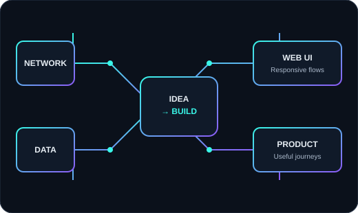

<!--
  MOSHAROF HOSSAIN — PACKETS TO PIXELS
  Profile README for: https://github.com/ShadinWorld
  Keep this repository named exactly ShadinWorld while the account username is ShadinWorld.
  Animated assets generated by the included GitHub Actions workflows appear after those workflows succeed.
-->

  

  

  
  
  
  

 

## `01 // SYSTEM PROFILE`

  <table>
    <tr>
      <td width="58%" valign="top">

**Hey, I'm Mosharof Hossain.** I'm a final-semester B.Sc. student in Computer Science & Engineering at **East West University**, Dhaka, with expected graduation in **December 2026**.

I like working where **networking fundamentals** meet **usable web products**. My academic and practical work includes multi-campus network simulations, web-based academic resources, a digital storefront, and data exploration.

- 📍 Dhaka, Bangladesh
- 🎓 B.Sc. in Computer Science & Engineering — East West University
- 🧭 Interested in networking, web technologies, and digital product development
- 🛠️ Best way to understand my work: explore the projects below

      </td>
      <td width="42%" valign="middle">
        

          
           
          <b>Approach:</b> understand the system → build the solution → test the details
        

      </td>
    </tr>
  </table>

## `02 // THE TOOLKIT`

### Web & Digital Products

  
  
  
  
  
  
  

### Networking & Infrastructure

  
  
  
  

**Topics practised:** IPv4 addressing, CIDR/subnetting, RIP, OSPF, EIGRP, DHCP/DHCP relay, VLAN, NAT, ACL, Cisco IOS CLI, and network troubleshooting commands.

### Programming, Data & Workflow

  
  
  
  
  
  
  
  
  
  
  

## `03 // FEATURED BUILDS`

> Different kinds of problems, one goal: make the result useful, understandable, and testable.

<table>
  <tr>
    <td width="50%" valign="top">
      <h3>◈ EWU StudyHub</h3>
      

      
Academic resource platform concept for discovering and accessing notes, question banks, assignments, and project resources.

      
Next.js · TypeScript · Tailwind CSS · Supabase

    </td>
    <td width="50%" valign="top">
      <h3>◈ Circuit Bazar</h3>
      

      
Digital storefront for an electronics-components business, supporting product discovery and customer enquiries.

      
React · Vite · Firebase · Tailwind CSS

    </td>
  </tr>
  <tr>
    <td width="50%" valign="top">
      <h3>◈ Laptop Price Analysis</h3>
      

      
Explored laptop-pricing data and created visualizations to compare pricing patterns and support data-informed decisions.

      
Python · Jupyter Notebook · Data Exploration

    </td>
    <td width="50%" valign="top">
      <h3>◈ Multi-Campus Network Simulation</h3>
      

      
Seven-router campus topology with connected LANs, IPv4 addressing and subnetting; practised routing protocols, DHCP relay, VLAN, NAT, ACL, and CLI-based connectivity checks.

      
Cisco Packet Tracer · Cisco IOS CLI

    </td>
  </tr>
</table>

  

## `04 // GITHUB TELEMETRY`

  
  

  

  

Stats cards are provided by community-hosted services. They may occasionally load slowly, hit rate limits, or be temporarily unavailable; they are not official GitHub analytics.

## `05 // CONTRIBUTION DIMENSION`

  <h3>Animated 3D contribution calendar</h3>
  <picture>
    <source media="(prefers-color-scheme: dark)" srcset="./profile-3d-contrib/profile-night-rainbow.svg" />
    <source media="(prefers-color-scheme: light)" srcset="./profile-3d-contrib/profile-season-animate.svg" />
    
  </picture>
    
  <h3>Contribution snake</h3>
  <picture>
    <source media="(prefers-color-scheme: dark)" srcset="https://raw.githubusercontent.com/ShadinWorld/ShadinWorld/output-snake/github-snake-dark.svg" />
    <source media="(prefers-color-scheme: light)" srcset="https://raw.githubusercontent.com/ShadinWorld/ShadinWorld/output-snake/github-snake.svg" />
    
  </picture>

## `06 // TROPHY CASE`

  

## `07 // CURRENT DIRECTION`

- Building and documenting practical web-based products.
- Strengthening networking fundamentals through simulations and troubleshooting.
- Improving how I explain technical work with clear project documentation and data visualizations.

I'm interested in **internship opportunities and collaborative projects** related to web technologies, IT networking, and digital product development.

  
  

  Thanks for stopping by. Keep learning, keep building, and keep making systems more useful. ✦
    
  

